# Screw Out

**A calm, tactile layered-plate puzzle.** Every sheet is a technical drawing
of stacked plates held down by screws. Unscrew in the right order, drop the
screws into a small tray, and release every plate. No timers, no lives, no
pressure: just a satisfying *click* when the last plate lifts off.

Built with Flutter for Android and iOS (phones and tablets), in a
"Blueprint" visual style: drafting-blue sheets, white line work, one yellow
action colour.

<p align="center">
  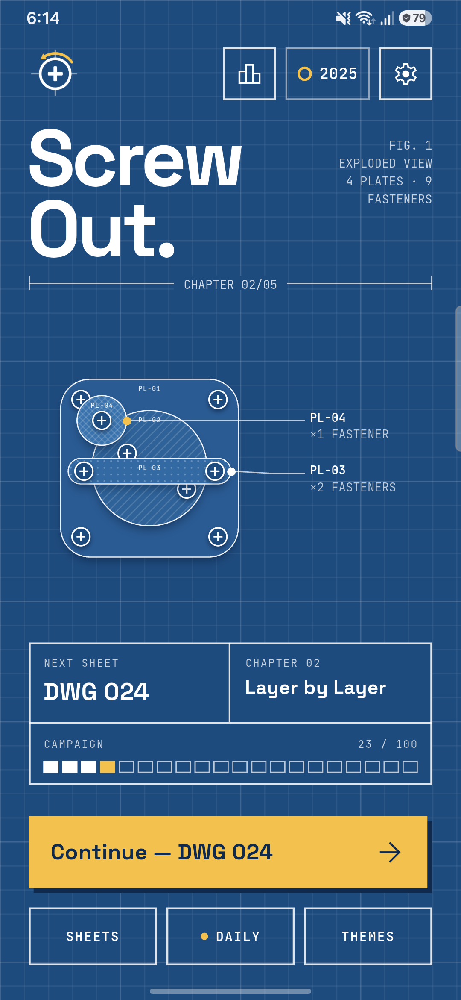
  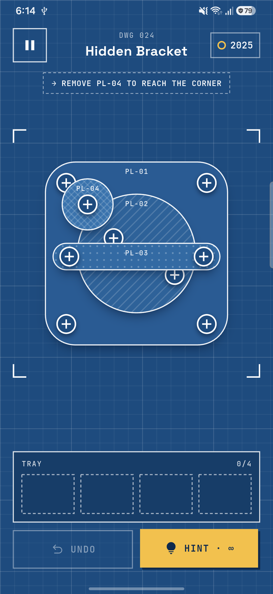
  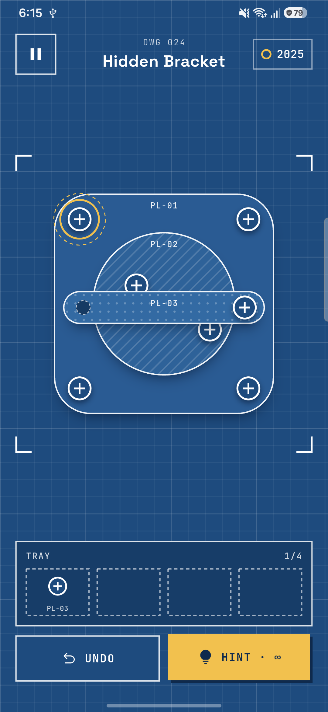
  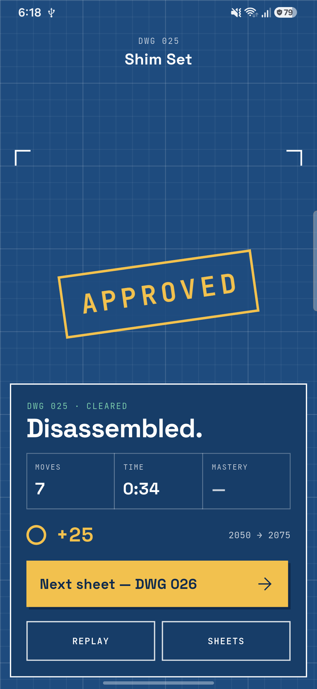
  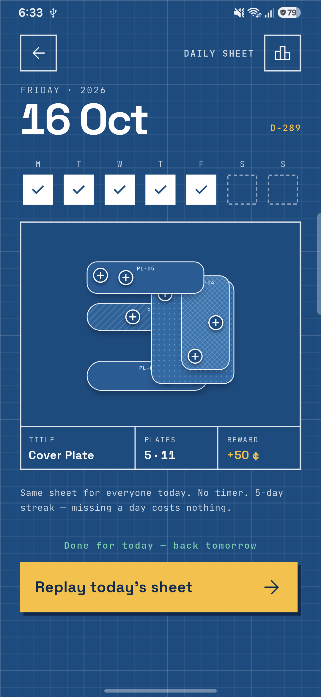
</p>

## Screenshots

### Phone

| Home | Gameplay | Tray | Hint |
|:---:|:---:|:---:|:---:|
|  |  | 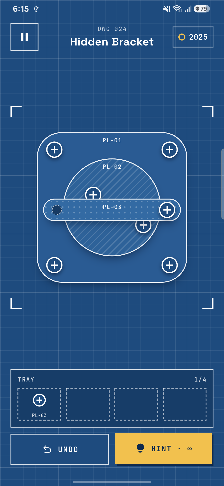 |  |
| **Sheet cleared** | **Chapter map** | **Campaign** | **Daily sheet** |
|  | 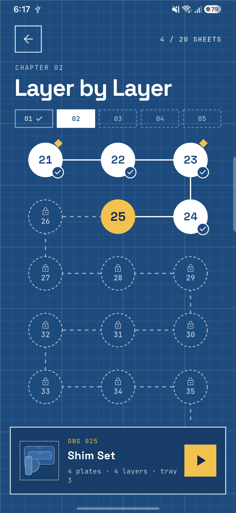 | 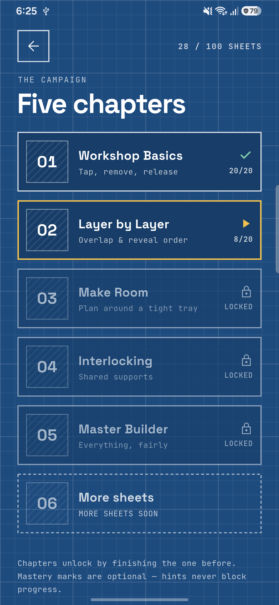 |  |
| **Themes** | **Leaderboards** | **Settings** | **Streaks** |
| 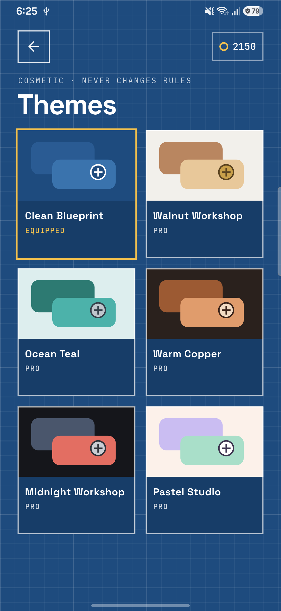 | 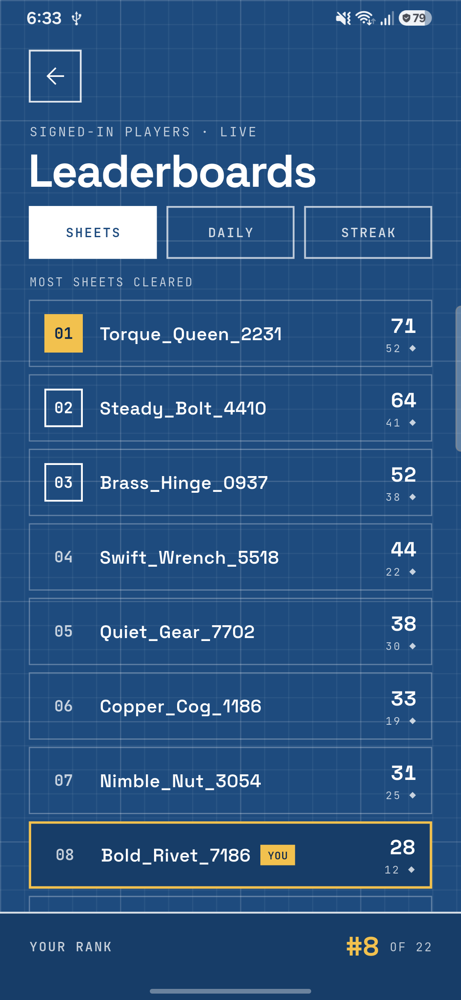 | 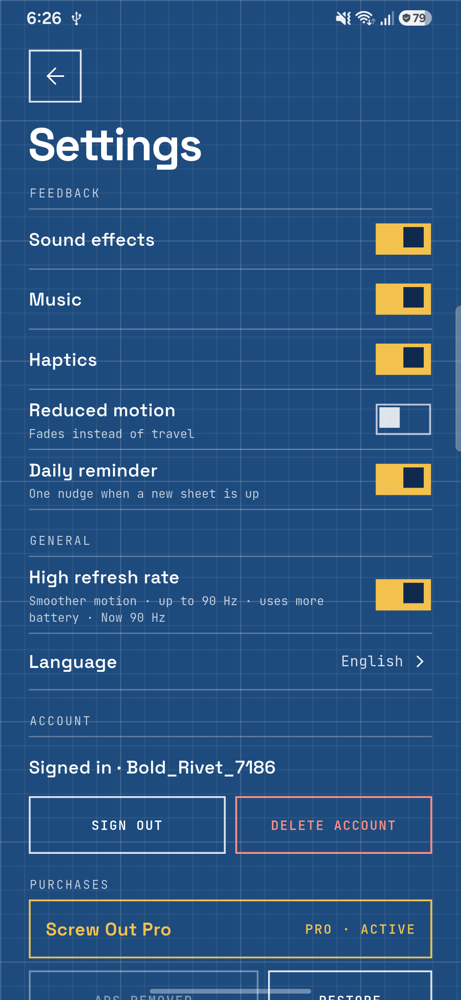 | 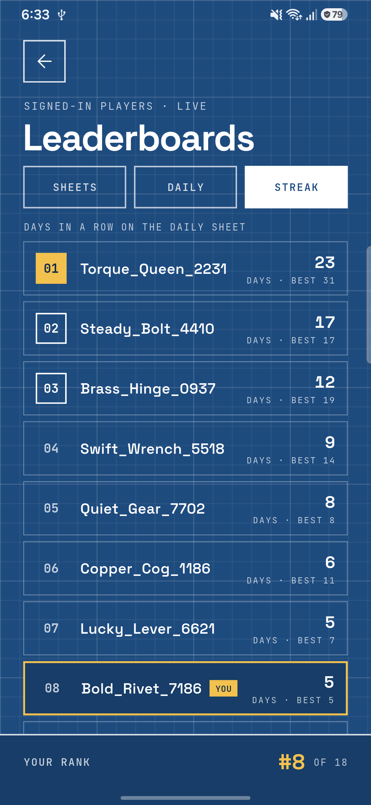 |

### Tablet

| Home | Gameplay | Hint | Sheet cleared |
|:---:|:---:|:---:|:---:|
| 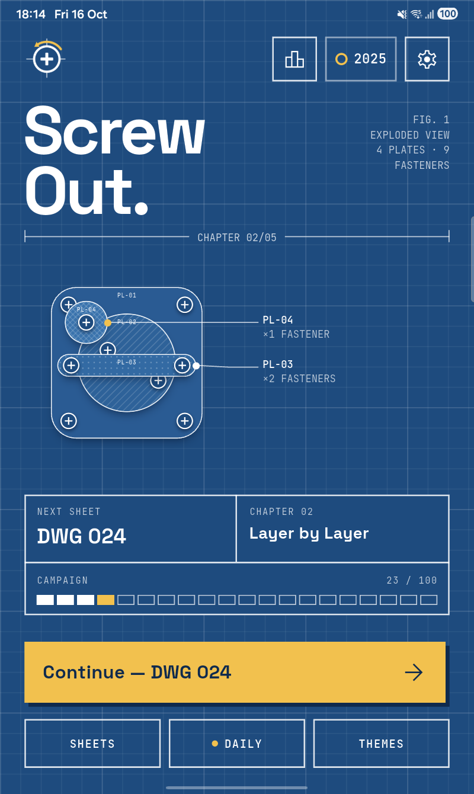 | 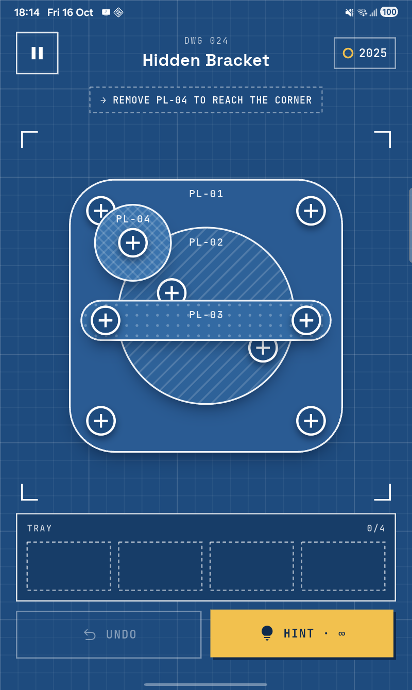 | 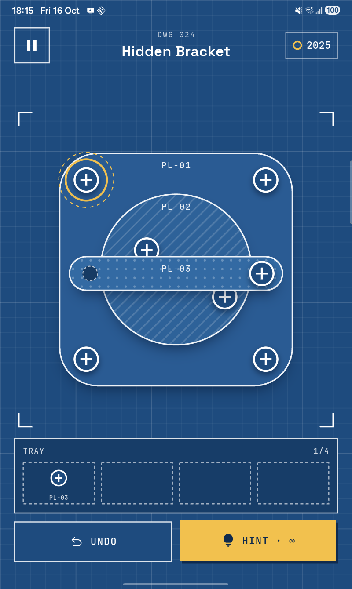 | 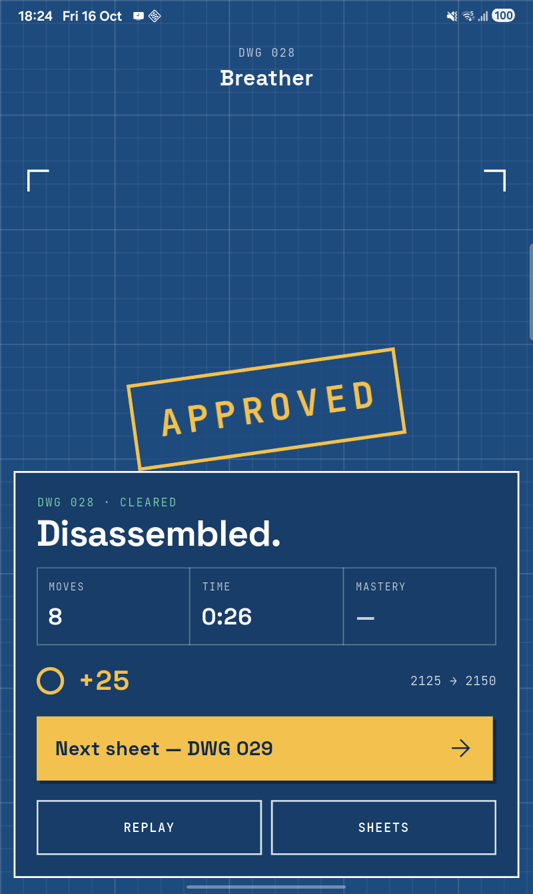 |
| **Chapter map** | **Daily sheet** | **Themes** | **Leaderboards** |
| 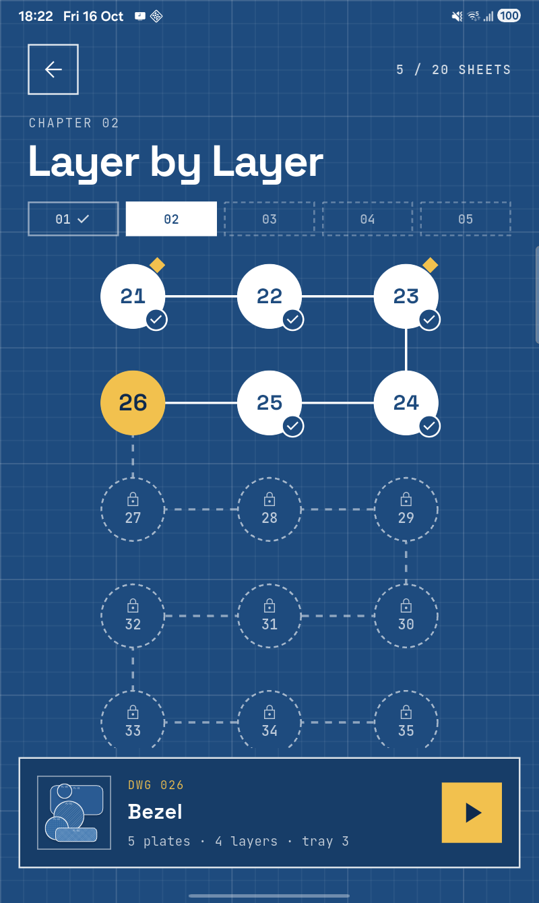 | 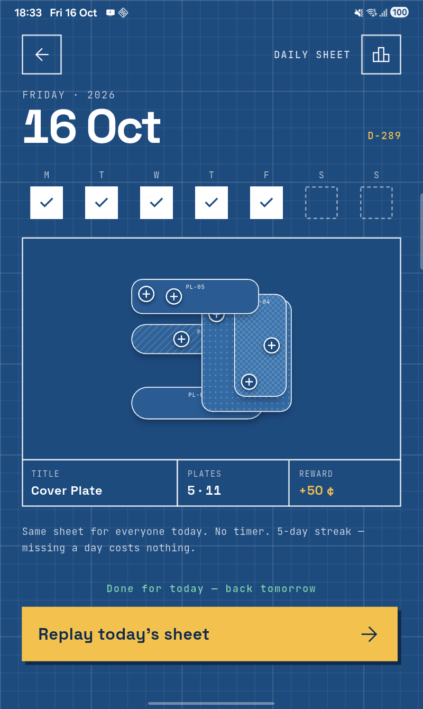 | 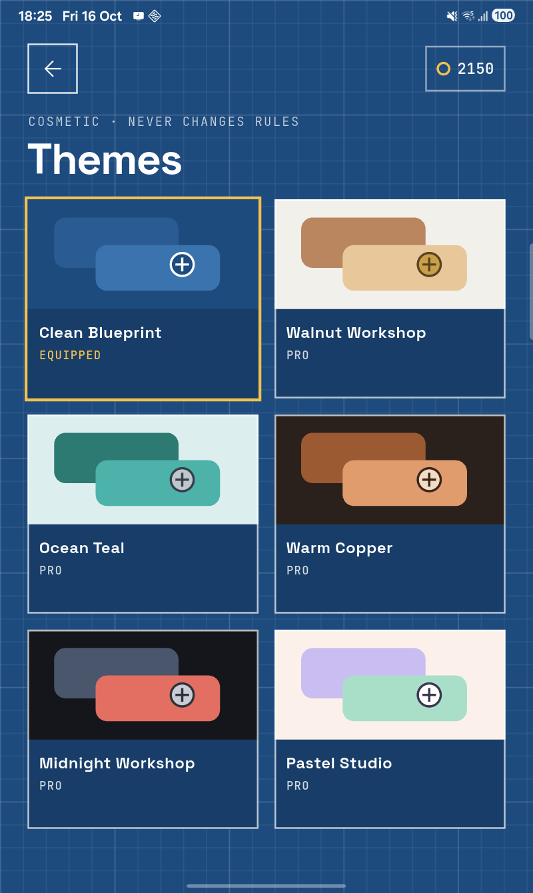 | 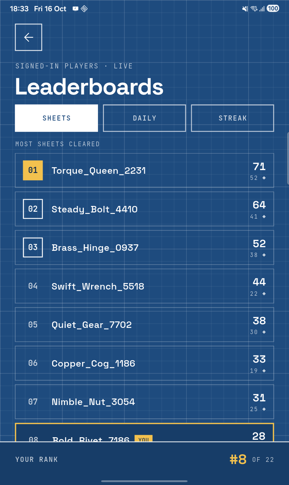 |

All 24 full-resolution captures (phone 1080×2340, tablet 800×1340) are in
[`screenshots/`](screenshots/).

## Features

- **100 hand-tuned sheets in 5 chapters**: Workshop Basics, Layer by Layer,
  Make Room, Interlocking and Master Builder. Every sheet is solver-validated
  to be solvable, and more chapter packs download from the backend past
  sheet 100.
- **Daily sheet**: the same deterministic sheet for everyone each day, with
  a week strip, streaks and a daily leaderboard. Missing a day costs nothing.
- **Hints and undo**: hints point at the next useful screw and never block
  progress. The ◆ mastery mark is optional (clear without hint, restart or
  rescue).
- **Stuck rescue**: when the tray fills up, get an extra slot (coins,
  rewarded ad, or free with Pro).
- **Leaderboards**: most sheets cleared, today's daily (fewest moves) and
  daily streaks, for signed-in players.
- **Themes**: Clean Blueprint plus five purely cosmetic themes (they never
  change the rules).
- **Offline-first**: everything works offline. Signing in with Google or
  Apple backs progress up and keeps phone and tablet in step, with clear
  notices ("Welcome back · 23 sheets restored", "Synced from your other
  device").
- **Sound**: an upbeat synthesised soundtrack and a matching SFX set, all
  generated in code (`tool/generate_audio.dart`), so every sound is ours.
- **Monetisation**: Remove ads, coin packs, theme packs and a **Pro**
  subscription (no ads, unlimited hints, all themes, free rescues, monthly
  coins). Ads are gentle: a menu banner and an occasional interstitial,
  never before the 15th clear.
- **Accessibility and polish**: reduced-motion mode, haptics, opt-in high
  refresh rate, scaled tablet layout and localisation via ARB files.

## Tech stack

| Area | Choice |
|---|---|
| UI / state | Flutter 3.47, `flutter_bloc` Cubits, `get_it`, `go_router` |
| Local data | Drift (SQLite) as the single source of truth, with a sync outbox |
| Accounts | Firebase Auth (guest-first, Google / Apple sign-in) → API JWT |
| Sync | Offline-first push queue + pull/merge (`lib/services/sync/`) |
| Purchases | `flutter_inapp_purchase`, verified server-side |
| Ads | `google_mobile_ads` (banner, interstitial, rewarded) with UMP consent |
| Push | Firebase Messaging + local notifications (daily reminder) |
| Audio | `flutter_soloud` (low-latency SFX + streamed Ogg music loop) |
| Analytics | Firebase Analytics + first-party telemetry to the API |

Backend: a .NET 10 API (auth, sync, purchases, leaderboards, level packs,
pushes and an admin dashboard) in a separate private repository.

## Project layout

```
lib/
├── core/           # DI, network (API client, connectivity), Blueprint theme tokens
├── data/           # Drift database (tables, migrations)
├── game/           # Pure game: domain, engine, solver, generator, level loading, board rendering
├── presentation/   # Cubits (auth, game, progress, premium, settings, display…)
├── screens/        # Home, gameplay, campaign, chapter map, daily, themes, leaderboards, settings…
├── services/       # Sync, accounts, purchases, ads, audio, notifications, analytics, progress
├── widgets/bp/     # Blueprint design-system widgets (buttons, sheets, toasts, grid)
├── l10n/           # ARB strings
└── router/         # go_router routes
tool/               # Level generator/validator, audio synthesiser, Ogg encoder
assets/             # Levels, fonts, audio, legal docs
test/               # Engine, solver, sync, services, screen and golden tests
```

## Getting started

Requirements: Flutter 3.47+ (Dart 3.13+), Android SDK and/or Xcode.

1. **Environment**: copy `.env.example` to `.env` and fill in:

   | Key | Purpose |
   |---|---|
   | `GOOGLE_WEB_CLIENT_ID` | OAuth *web* client id of the Firebase project (Google sign-in `serverClientId`) |
   | `DEV_API_BACKEND_URL` | Debug builds: LAN address of a local API, e.g. `http://192.168.1.10:8394` |
   | `PROD_API_BACKEND_URL` | Release builds: the deployed API |

   `.env` is bundled as an asset, so put **only public values** in it.

2. **Firebase**: these are git-ignored, so add your own:
   `lib/firebase_options.dart` (via `flutterfire configure`),
   `android/app/google-services.json` and `ios/Runner/GoogleService-Info.plist`.

3. **Generate code and run**:

   ```bash
   flutter pub get
   dart run build_runner build --delete-conflicting-outputs   # Drift
   flutter gen-l10n
   flutter run
   ```

4. **Release signing (Android)**: create `android/key.properties`
   (git-ignored) pointing at your keystore:

   ```properties
   storePassword=…
   keyPassword=…
   keyAlias=…
   storeFile=/absolute/path/to/release.jks
   ```

   Then `flutter build appbundle --release`.

The app runs fully offline without the backend. Sign-in, sync,
leaderboards, purchases and pushes need the API.

## Tooling

```bash
flutter test                                   # unit, widget and golden tests
flutter analyze

dart run tool/validate_levels.dart             # solver-check every bundled sheet
dart run tool/generate_levels.dart             # regenerate the level packs

dart run tool/generate_audio.dart              # synthesise all SFX + the music loop
python tool/encode_music.py                    # music WAV → Ogg Vorbis (needs: pip install soundfile numpy)
```

Debug builds have a QA panel (long-press the version footer in Settings) to
jump to sheets, add coins and reset progress.

## License

All rights reserved. The source is public to read; the game, its art,
levels and sounds are not licensed for redistribution.
